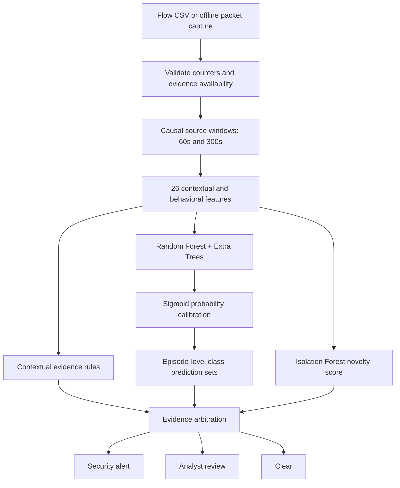
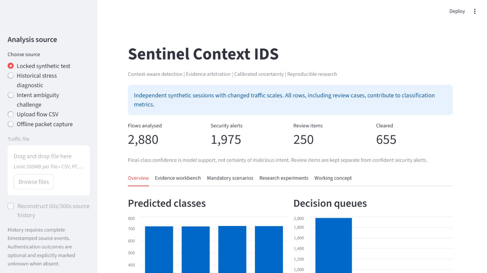

# Sentinel Context IDS

**Context-aware, uncertainty-aware network intrusion detection research prototype.**

Sentinel analyses flow CSVs or offline PCAP/PCAPNG captures, reconstructs source history, and combines calibrated machine learning with contextual evidence. Its purpose is to reduce two concrete errors from a simpler IDS: missing slow scans and treating legitimate high-volume transfers as DoS.

> **Measured scope:** 99.34% accuracy and 99.34% macro F1 on 2,880 independently generated, scale-shifted **synthetic** test flows. This is not real-network accuracy, a world-first claim, or evidence of universal superiority to established IDS products.

## What improved

| Experiment | Frozen previous prototype | Sentinel |
| --- | ---: | ---: |
| Same locked synthetic test: all-row accuracy | 62.08% | **99.34%** |
| Same locked test: macro F1 | 54.22% | **99.34%** |
| Same locked test: raw class false-positive rate | 50.28% | **1.39%** |
| Previously observed 300-row stress diagnostic: accuracy | 15.00% | **88.33%** |

The old and new models use different training coverage; these comparisons measure the complete systems, not an isolated algorithm improvement. The core-only new ensemble already reaches 99.31%; adding context reaches 99.34%, and rules leave the final class accuracy unchanged in this test. Better data coverage is the main contributor. Historical stress was known during development and is not an untouched benchmark.

Sentinel sends **8.68%** of locked-test flows to review. Confident-alert precision is 99.85% and recall is 91.30%; those alert metrics exclude review items. Accepted coverage is 91.32%, with 99.54% accuracy on accepted rows. Always read accuracy, review workload and missed alerts together. [Full experiments](docs/EXPERIMENTS.md).

## Quick start

Python 3.13 was tested on Windows. GitHub Actions is configured for Python 3.13 on Linux.

```powershell
python -m venv .venv
.venv\Scripts\Activate.ps1
python -m pip install -r requirements.txt
python run_ids.py build
python -m pytest -q
python run_ids.py benchmark
python -m streamlit run app.py
```

On Linux/macOS use `source .venv/bin/activate`. If PowerShell activation is restricted, invoke `.venv\Scripts\python.exe` directly instead. Open the localhost URL printed by Streamlit.

**Source checkout:** generated datasets, models and large prediction tables are intentionally rebuilt, not downloaded as opaque binaries. Build also reconstructs the frozen v2 baseline from the included legacy generator and fixed training recipe. The downloadable local ZIP includes generated artifacts for inspection. No account, API key, packet driver or administrator privilege is required for offline inference.

## Use your own traffic

```powershell
python run_ids.py detect data/example_unlabeled.csv --output results/custom_predictions.csv
python run_ids.py detect path/to/events.csv --aggregate-context --output results/context_predictions.csv
python run_ids.py pcap path/to/capture.pcap --output results/capture_predictions.csv
```

CSV inputs need nine numeric base fields; authentication failures are optional and tracked as known/unknown. Complete timestamped source observations enable causal history. Labels and scenario metadata are optional. PCAP ingestion counts observable TCP/UDP evidence and marks authentication outcomes unavailable. [Exact input contract and capture limitations](docs/DATA_CONTRACT.md).

## Working concept



- **Slow scan context:** port diversity, entropy and new-port fraction over two horizons.
- **Backup-aware flood reasoning:** rate alone is insufficient; require corroborating handshake or service-baseline evidence.
- **Probability calibration:** distinct development sessions calibrate the forest/Extra Trees mixture.
- **Uncertainty and novelty:** class prediction sets, unfamiliar-feature detection and evidence conflicts generate review reasons.
- **Honest unknowns:** missing authentication outcomes, incomplete capture and truncated history are explicit.
- **Intent ambiguity:** traffic counters do not reveal administrative permission; the challenge demonstrates that limit rather than inventing perfect detection.

These are established ideas combined in a focused research prototype. Suricata already has sophisticated thresholding and Zeek already supports scan monitoring. This project targets weaknesses of the included simple baseline; it does not claim those tools lack these capabilities. [Prior art and contribution boundaries](docs/RESEARCH_AND_PRIOR_ART.md).

## Reproducible study design

| Partition | Seed | Rows | Independent sessions | Purpose |
| --- | ---: | ---: | ---: | --- |
| Training | 42 | 3,840 | 320 | Fit ensemble, service baselines and novelty model |
| Probability calibration | 43 | 1,152 | 96 | Fit sigmoid calibrator |
| Prediction-set calibration | 44 | 1,152 | 96 | Episode-level worst-member nonconformity scores |
| Validation | 45 | 1,152 | 96 | Select review-probability threshold |
| Locked final test | 20261025 | 2,880 | 240 | Evaluate changed scales and unseen sessions/sources |

`python run_ids.py develop` fits and freezes development artifacts. `python run_ids.py evaluate` checks the freeze and evaluates the locked test. `build` runs both in that order. The final seed is fixed in the study plan. Model/decision hashes, partition manifests and an AST-preserving formatting provenance record document what was frozen. Rebuilding produces a fresh freeze before evaluation; timing and pickle bytes may differ by environment.

The synthetic generator contains benign web, bulk backup, administrative fanout, DNS bursts and legitimate authentication, plus multiple scan/flood/password-attack profiles. No labels, source addresses or scenario names enter the model vector. [Data generation and evaluation details](docs/EXPERIMENTS.md).

## Dashboard



Five views provide a working demonstration:

1. **Overview:** distributions and alert/review/clear counts.
2. **Evidence workbench:** one complete decision, model support, prediction set, rule evidence and measured features.
3. **Mandatory scenarios:** benign, scan, DoS, brute force, and ambiguous/review/error cases.
4. **Research experiments:** baselines, ablations, confidence interval, calibration and performance measurements.
5. **Working concept:** each failure mode and the implemented response.

Saved benchmark metrics always refer to their named experiment, not an uploaded file. Historical stress and the hidden-authorization challenge are separate analysis sources.

## Documentation

[Download the technical report PDF](docs/Sentinel_Technical_Report.pdf) | [Download the complete concept handbook PDF](docs/Sentinel_Working_Concept_Handbook.pdf)

To rebuild these PDFs: install `requirements-docs.txt`, then run `python tools/render_docs.py`.

- [Complete working-concept handbook](docs/WORKING_CONCEPT.md): networking basics, equations, algorithms, decision trace, usefulness and operational limits.
- [Technical report](docs/TECHNICAL_REPORT.md): assessment-length report.
- [Research and prior art](docs/RESEARCH_AND_PRIOR_ART.md): hypotheses, sources, novelty boundaries and negative results.
- [Experiments and interpretation](docs/EXPERIMENTS.md): exact metrics, fair comparisons and evidence scope.
- [Data contract](docs/DATA_CONTRACT.md): all fields, units, provenance and packet aggregation.
- [Model card](docs/MODEL_CARD.md): intended use, data, metrics, uncertainty and restrictions.
- [Deployment and threat model](docs/DEPLOYMENT.md): ingestion trust, performance, privacy and extension roadmap.
- [Interview questions](docs/INTERVIEW_GUIDE.md): concepts and decisions the candidate should be able to explain.
- [Video storyboard](docs/VIDEO_SCRIPT.md): running-system demonstration, approximately nine minutes.
- [Assessment requirement matrix](docs/REQUIREMENTS_MATRIX.md).
- [Verification record](docs/QUALITY_CHECKS.md) and [command log](docs/VERIFICATION_LOG.txt).

## Project layout

```text
sentinel/        validation, temporal features, calibrated model, rules, capture, experiments
baselines/       previous prototype recipe and generator for reproducible comparisons
tests/           validation, causality, evidence policy, capture, leakage and UI regression tests
data/            generated datasets and minimal unlabeled example
artifacts/       generated trained models
results/         generated predictions, metrics, comparisons, manifests and timings
docs/            research documentation, report and conceptual handbook
tools/           documentation rendering and offline example generation
app.py           analyst dashboard
run_ids.py       build / develop / evaluate / detect / pcap / benchmark
```

## Development quality

```powershell
python -m pip install -r requirements-dev.txt
python -m black --check sentinel tests app.py run_ids.py
python -m ruff check --select E9,F63,F7,F82 .
python -m pytest -q
```

Tests include malformed/empty data, unknown authentication, exact window expiry, future-event isolation, source separation, bounded history, rule evidence, calibrated queue semantics, model round trips, independent source/session checks, freeze integrity, actual PCAP counts, and every dashboard scenario. The project does not send packets or contain attack-launching utilities.

## Limits and responsible interpretation

There is no public-dataset or live-network efficacy result. A fixed synthetic generator can leave class-specific shortcuts; changing seeds and scales is stronger than reusing training rows but much weaker than testing another network. Calibration and prediction sets depend on distribution assumptions; on historical stress, prediction-set coverage falls to 50%. Missing history routes recognized legacy scans to review, so historical stress class recognition must not be presented as confident-alert recall.

The intent challenge has identical visible features with conflicting authorization labels: accuracy remains 50%, and only 41.67% of events are reviewed after enough fanout appears. Early observations remain a blind spot. Distributed sources, encrypted applications, spoofing, NAT, packet loss and novel attack families are unresolved. This is an analyst-assistance research prototype, not an autonomous blocking product.

AI tools assisted development, research and review. The candidate must review the source, understand every claim and explain the work personally. GitHub publication does not replace the required recorded demonstration.
